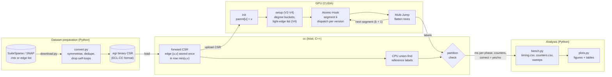
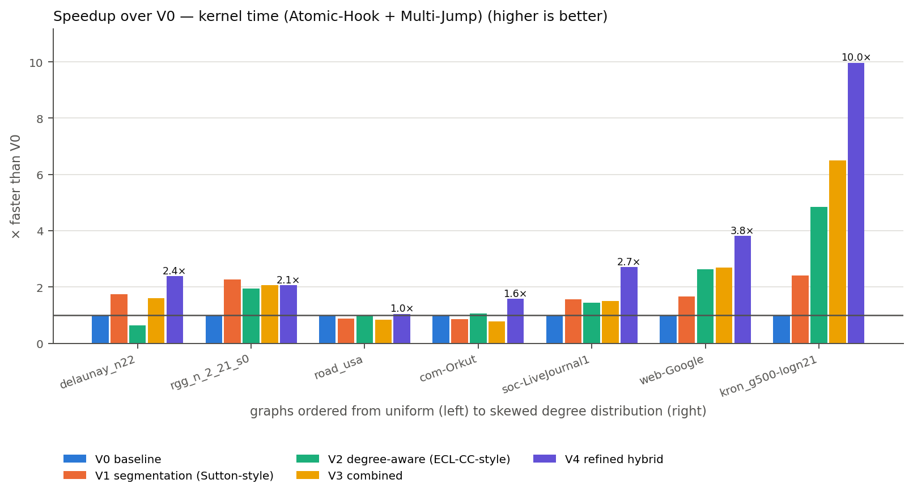
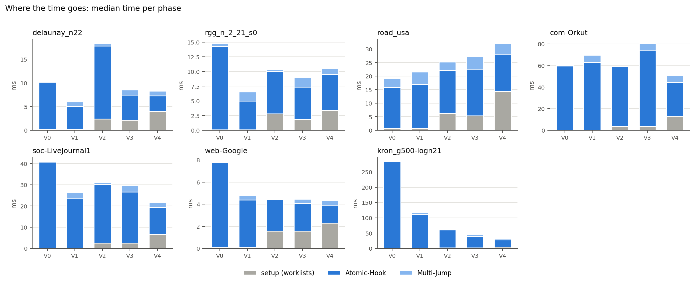
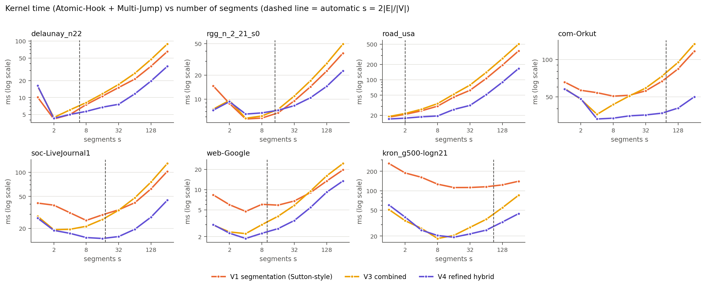
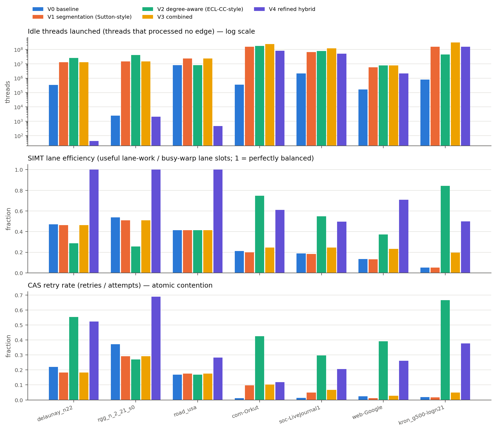
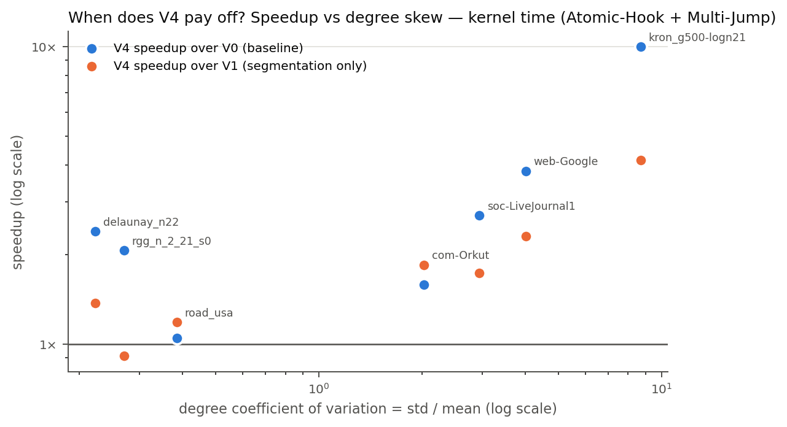
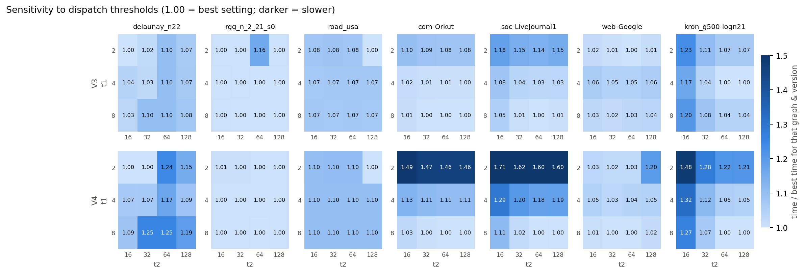

# Adaptive Parallel Connected Components for Large Sparse Graphs

A CUDA study of two load-balancing ideas for GPU connected components (union-find), and of what happens when they are combined:

- **adaptive segmentation** (Sutton et al., 2016): process the edges in `s` rounds so that hooks inside one round compete less for the same roots;
- **degree-aware dispatch** (ECL-CC, Jaiganesh & Burtscher, 2018): give low-degree vertices a thread, medium ones a warp and high-degree ones a block.

Five versions share the same Atomic-Hook and Multi-Jump code and differ only in how edges are split into segments and handed to GPU threads. V0–V3 are the planned 4-way ablation. V4 is a refinement added after the ablation's counter data showed where V3 loses time. Every run of every version is checked against a sequential CPU reference.

**Headline result** (RTX 3050 Laptop GPU, kernel time = Atomic-Hook + Multi-Jump, median of 5 runs): V4 is the fastest of the five variants on 6 of the 7 graphs, by a wide margin on skewed graphs (10.0× over V0 and 1.53× over V3 on `kron_g500-logn21`) and by small margins on uniform ones. Including setup time, it is fastest on the 4 skewed graphs, while V1 or V0 win on the uniform ones. See [Results](#results).

IT306 Parallel and Distributed Problem Solving, NITK Surathkal — Team 7.

---

## Contents
- [Architecture](#architecture)
- [The five versions](#the-five-versions)
- [Results](#results)
- [Metrics and counters](#metrics-and-counters)
- [Datasets and sources](#datasets-and-sources)
- [Correctness testing](#correctness-testing)
- [Repository structure](#repository-structure)
- [Quick start](#quick-start)
- [Design decisions](#design-decisions)
- [Scope and limitations](#scope-and-limitations)
- [Team](#team)
- [References](#references)

Full step-by-step instructions to recreate every number and figure: **[REPRODUCE.md](REPRODUCE.md)**.

---

## Architecture



1. `download.py` fetches each graph and `convert.py` turns it into a symmetric, duplicate-free binary CSR file (`.egr`, the format used by ECL-CC).
2. `cc` loads the file and builds a **forward CSR**: every undirected edge is stored once, in the row of its smaller endpoint. All versions run on this same structure.
3. On the GPU, every vertex starts as its own tree. V2–V4 then build their worklists (setup).
4. For each of the `s` segments, **Atomic-Hook** merges trees along that segment's edges (how the edges are split and assigned is the only thing that differs between versions), then **Multi-Jump** makes every vertex point directly at its root.
5. The final labels are compared with a sequential CPU union-find. A run counts only if the two partitions are identical.
6. `bench.py` repeats this across graphs, versions and parameter sweeps; `plots.py` produces the figures and tables in [`results_rtx3050_laptop/`](results_rtx3050_laptop).

---

## The five versions

| Version | Segments `s` | Who processes the edges | What it isolates |
|---|---|---|---|
| **V0** baseline | 1 | one thread per vertex, whole neighbour list | the reference point |
| **V1** segmentation (Sutton-style) | `round(2\|E\|/\|V\|)` | one thread per vertex, one slice of its list per segment | adaptive segmentation |
| **V2** degree-aware (ECL-CC-style) | 1 | thread / warp / block chosen by degree | degree-aware dispatch |
| **V3** combined | `round(2\|E\|/\|V\|)` | thread / warp / block chosen by in-segment degree | the planned combination |
| **V4** refined hybrid | `round(2\|E\|/\|V\|)` | light vertices: one thread **per edge** from a flat light-edge list; heavy vertices: slices with warp / block dispatch, as in V3 | V3 without its idle threads |

**Option B segmentation (V1, V3, V4).** Segment `k` of vertex `v` with forward degree `d` covers neighbour positions
`[off[v] + ⌊k·d/s⌋, off[v] + ⌊(k+1)·d/s⌋)`. Every vertex contributes about `d/s` edges to every segment, and the slices cover each row exactly once. A vertex of degree 1000 with `s = 20` hooks 50 edges per segment.

**Dispatch (V2, V3, V4).** In-segment degree `⌈d/s⌉ ≤ t1` → thread, `≤ t2` → warp (32 threads), larger → block (256 threads). Defaults `t1 = 4`, `t2 = 32`. With `s = 1` this is plain degree-based dispatch (V2).

**Why V4 exists.** The counter build showed that V3 launches a thread for every vertex in every segment (`s × |V|` threads), most of which find an empty slice: about 240 million idle threads on `com-Orkut`, which has 3 million vertices. V4 keeps V3's treatment of high-degree vertices but moves all edges of low-degree ("light") vertices into one flat list, hooked one thread per edge in `s` contiguous chunks. The light list is built on the GPU in every run, and that time is reported as setup.

---

## Results

All numbers below are from [`results_rtx3050_laptop/`](results_rtx3050_laptop): NVIDIA GeForce RTX 3050 6 GB Laptop GPU (sm_86), WSL2 Ubuntu 24.04, CUDA 12.6, median of 5 timed runs after 1 warm-up, every run verified.

**Kernel time** (Atomic-Hook + Multi-Jump), ms. Graphs ordered from uniform to skewed degree distribution; **bold** = fastest of the five.

| Graph | V0 | V1 | V2 | V3 | V4 |
|---|---:|---:|---:|---:|---:|
| delaunay_n22 | 10.19 | 5.85 | 15.86 | 6.36 | **4.26** |
| rgg_n_2_21_s0 | 14.70 | **6.48** | 7.52 | 7.11 | 7.12 |
| road_usa | 18.44 | 20.89 | 18.98 | 21.76 | **17.60** |
| com-Orkut | 59.65 | 69.39 | 55.79 | 76.87 | **37.60** |
| soc-LiveJournal1 | 40.74 | 26.09 | 28.31 | 26.95 | **15.03** |
| web-Google | 7.75 | 4.68 | 2.94 | 2.87 | **2.03** |
| kron_g500-logn21 | 283.60 | 117.99 | 58.43 | 43.64 | **28.44** |

**Total time** (including setup: worklists and, for V4, the light-edge list), ms.

| Graph | V0 | V1 | V2 | V3 | V4 |
|---|---:|---:|---:|---:|---:|
| delaunay_n22 | 10.35 | **6.02** | 18.35 | 8.51 | 8.29 |
| rgg_n_2_21_s0 | 14.80 | **6.57** | 10.30 | 8.95 | 10.49 |
| road_usa | **19.08** | 21.55 | 25.27 | 27.09 | 32.02 |
| com-Orkut | 59.87 | 69.58 | 59.26 | 80.17 | **50.64** |
| soc-LiveJournal1 | 40.93 | 26.27 | 30.84 | 29.48 | **21.64** |
| web-Google | 7.85 | 4.78 | 4.67 | 4.46 | **4.35** |
| kron_g500-logn21 | 283.67 | 118.12 | 61.11 | 45.64 | **33.40** |

### Figures

| | |
|---|---|
|  **Fig. 1** Speedup over V0 (kernel time). |  **Fig. 2** Setup, Atomic-Hook and Multi-Jump time per version. |
|  **Fig. 3** Kernel time vs number of segments `s` (dashed: automatic `s`). |  **Fig. 4** Idle threads, SIMT lane efficiency and CAS retry rate. |
|  **Fig. 5** V4 speedup vs degree skew. |  **Fig. 6** Sensitivity of V3 and V4 to the dispatch thresholds. |

Total-time versions of Figs. 1, 3 and 5 are in [`figures/total/`](results_rtx3050_laptop/figures/total). Tables in CSV and LaTeX are in [`figures/`](results_rtx3050_laptop/figures).

### What the results show
- **Segmentation (V1)** helps on most graphs, by up to 2.4× over V0 on `kron`. **Dispatch (V2)** helps more on skewed graphs (4.9× on `kron`) but hurts on the mesh `delaunay_n22`.
- **Combining them as planned (V3)** beats both V1 and V2 only on the two most skewed graphs (`web-Google`, `kron`). The counters explain why: Option B launches every vertex in every segment, leaving up to 3.1 × 10⁸ idle threads (`kron`).
- **V4 removes most of those idle threads** (from 12.9 million to 43 on `delaunay_n22`, and by 50–73 % on the skewed graphs) and keeps cooperative processing of hubs. It is the fastest variant on 6 of 7 graphs in kernel time; on uniform graphs the margin is small (5 % on `road_usa`, a tie with V1 on `rgg_n_2_21_s0`).
- **Fewer CAS retries did not mean faster runs.** On the skewed graphs V0 and V1 have the fewest retries and are among the slowest, and V4 has 1.2–12× more retries than V3 yet is faster. Atomic contention is not the bottleneck on this GPU.
- **The automatic `s = 2|E|/|V|` is often far above the best value.** In the sweep, V3 and V4 are fastest at `s` between 1 and 16 on every graph, while the rule picks 76 on `com-Orkut` and 87 on `kron` (Fig. 3).
- **V4's setup cost** (2–14 ms) is what separates the kernel-time and total-time views. On uniform graphs it outweighs the kernel gain.
- **V0 is noisy on skewed graphs** (9–14 % run-to-run variation), because one thread walks each hub's entire list and its timing depends on scheduling. Speedups over V0 on those graphs are therefore less precise than comparisons among V1, V3 and V4, which vary by under 1 %. V2 also varies by up to 12 % on some graphs.

---

## Metrics and counters

**Timing build** (`bin/cc`, writes `timing.csv`), CUDA events around each phase:
| Column | Meaning |
|---|---|
| `setup_ms` | init + worklist construction (V2–V4) + light-edge list (V4) |
| `hook_ms` | all Atomic-Hook kernels, summed over segments |
| `jump_ms` | all Multi-Jump kernels, summed over segments |
| `total_ms` | init to last Multi-Jump |
| kernel time | `hook_ms + jump_ms` (headline metric) |
| `n_thread`, `n_warp`, `n_block` | vertices in each dispatch bucket (`n_thread` = light vertices for V4) |
| `light_edges` | V4 only: edges hooked one thread per edge |
| `mem_bytes` | device memory the version needs |
| `correct` | 1 if the labelling matches the CPU reference |

File loading, host preprocessing and the host-to-device copy are identical for all versions and are not timed.

**Counter build** (`bin/cc_counters`, writes `counters.csv` and per-segment `segments.csv`; never used for timing):
| Column | Meaning |
|---|---|
| `cas_attempts`, `cas_retries` | atomicCAS calls in Atomic-Hook, and how many lost a race (contention) |
| `find_steps` | parent-pointer hops while finding roots (tree depth) |
| `simt_efficiency` | Σ lane work / Σ (32 × max lane work) over busy warps; 1 = every lane of a busy warp did equal work |
| `imbalance` | max lane work / mean lane work over busy lanes |
| `idle_threads` | launched threads that processed no edge |

**`stats.csv`**: vertices, edges, average / max degree, degree standard deviation and coefficient of variation, isolated vertices, components, largest component, automatic `s`.

---

## Datasets and sources

Seven public graphs, chosen to span uniform to highly skewed degree distributions. `|E|` counts undirected edges after symmetrising, removing duplicates and removing self-loops. Degree CV = standard deviation / mean of the degree.

| Graph | Type | \|V\| | \|E\| | Avg deg | Max deg | Degree CV | Components | Source |
|---|---|---:|---:|---:|---:|---:|---:|---|
| delaunay_n22 | 2-D mesh | 4,194,304 | 12,582,869 | 6.00 | 23 | 0.22 | 1 | SuiteSparse (DIMACS10) |
| rgg_n_2_21_s0 | random geometric | 2,097,152 | 14,487,995 | 13.82 | 37 | 0.27 | 8 | SuiteSparse (DIMACS10) |
| road_usa | road network | 23,947,347 | 28,854,312 | 2.41 | 9 | 0.39 | 1 | SuiteSparse (DIMACS10) |
| com-Orkut | social | 3,072,441 | 117,185,083 | 76.28 | 33,313 | 2.03 | 1 | SNAP |
| soc-LiveJournal1 | social | 4,847,571 | 42,851,237 | 17.68 | 20,333 | 2.94 | 1,876 | SNAP |
| web-Google | web | 875,713 | 4,322,051 | 9.87 | 6,332 | 4.02 | 2,746 | SNAP |
| kron_g500-logn21 | synthetic power-law (Graph500 Kronecker) | 2,097,152 | 91,040,932 | 86.82 | 213,904 | 8.70 | 553,159 | SuiteSparse (DIMACS10) |

**Where to get them.** `python3 tools/download.py` fetches and converts all seven automatically. To download by hand instead:

| Graph | Page | File |
|---|---|---|
| road_usa | [SuiteSparse](https://sparse.tamu.edu/DIMACS10/road_usa) · [UF mirror](https://www.cise.ufl.edu/research/sparse/matrices/DIMACS10/road_usa.html) | [road_usa.tar.gz](https://www.cise.ufl.edu/research/sparse/MM/DIMACS10/road_usa.tar.gz) (Matrix Market) |
| delaunay_n22 | [SuiteSparse](https://sparse.tamu.edu/DIMACS10/delaunay_n22) · [UF mirror](https://www.cise.ufl.edu/research/sparse/matrices/DIMACS10/delaunay_n22.html) | [delaunay_n22.tar.gz](https://www.cise.ufl.edu/research/sparse/MM/DIMACS10/delaunay_n22.tar.gz) |
| rgg_n_2_21_s0 | [SuiteSparse](https://sparse.tamu.edu/DIMACS10/rgg_n_2_21_s0) · [UF mirror](https://www.cise.ufl.edu/research/sparse/matrices/DIMACS10/rgg_n_2_21_s0.html) | [rgg_n_2_21_s0.tar.gz](https://www.cise.ufl.edu/research/sparse/MM/DIMACS10/rgg_n_2_21_s0.tar.gz) |
| kron_g500-logn21 | [SuiteSparse](https://sparse.tamu.edu/DIMACS10/kron_g500-logn21) · [UF mirror](https://www.cise.ufl.edu/research/sparse/matrices/DIMACS10/kron_g500-logn21.html) | [kron_g500-logn21.tar.gz](https://www.cise.ufl.edu/research/sparse/MM/DIMACS10/kron_g500-logn21.tar.gz) |
| web-Google | [SNAP](https://snap.stanford.edu/data/web-Google.html) | [web-Google.txt.gz](https://snap.stanford.edu/data/web-Google.txt.gz) (edge list) |
| soc-LiveJournal1 | [SNAP](https://snap.stanford.edu/data/soc-LiveJournal1.html) | [soc-LiveJournal1.txt.gz](https://snap.stanford.edu/data/soc-LiveJournal1.txt.gz) |
| com-Orkut | [SNAP](https://snap.stanford.edu/data/com-Orkut.html) | [com-orkut.ungraph.txt.gz](https://snap.stanford.edu/data/bigdata/communities/com-orkut.ungraph.txt.gz) |

The SuiteSparse download links on `sparse.tamu.edu` returned "Access Denied" during this project; the University of Florida mirror served the identical Matrix Market files. The download script tries the mirror first. Conversion steps for manually downloaded files are in [REPRODUCE.md](REPRODUCE.md#4-get-the-datasets).

**Test graphs.** The 12 graphs in `data/tests/` are **small synthetic graphs for correctness testing only** (paths, stars, cliques, grids, random and power-law graphs, plus edge cases). They are generated by [`tools/gen_tests.py`](tools/gen_tests.py) with a fixed seed and are not part of the benchmark. Their expected sizes and component counts are in [`tests/expected_test_stats.csv`](tests/expected_test_stats.csv).

---

## Correctness testing

- **CPU reference.** Every run's labels are compared with a sequential union-find (path halving, union by size). Labels need not be equal, only the partitions: the check verifies that the mapping between GPU and CPU labels is one-to-one.
- **12 test graphs** ([`tools/gen_tests.py`](tools/gen_tests.py)), each aimed at a specific way the GPU code could fail:

| Test graph | What it stresses |
|---|---|
| `path_ordered`, `path_shuffled` | very deep trees (Multi-Jump must flatten them) |
| `star_low`, `star_high` | one vertex of degree 100,000 at the lowest / highest id → block dispatch, heavy CAS contention on one root |
| `isolated` | mostly degree-0 vertices |
| `cliques` | 200 dense components → warp and block buckets |
| `messy_onedir` | one-directional storage, duplicates and self-loops, written raw to test the loader |
| `grid` | 2-D mesh, large diameter, uniform degree |
| `er_random`, `powerlaw` | uniform random graph; power-law graph with hubs |
| `single_vertex`, `two_vertices` | edge cases |

- `make tests` runs all five versions on all 12 graphs on the GPU and checks the generated graphs against [`tests/expected_test_stats.csv`](tests/expected_test_stats.csv). The log from our GPU is in [`tests/gpu_test_log_rtx3050_laptop.txt`](tests/gpu_test_log_rtx3050_laptop.txt).
- `make emutests` runs the same kernel code sequentially on the CPU. This proves every version hooks every edge exactly once, but cannot test races between GPU threads.
- All 175 timed benchmark runs, 35 counter runs and 1,323 sweep runs in `results_rtx3050_laptop/` produced the correct partition.

---

## Repository structure

```
gpu-cc-ablation/
├── README.md                      this file
├── REPRODUCE.md                   step-by-step guide to recreate every result
├── LICENSE                        MIT
├── Makefile                       Linux / WSL build: make, make counters, make tests, make emutests
├── build.bat                      native Windows build (Visual Studio + CUDA)
├── src/
│   ├── graph.h                    .egr reader, forward CSR, CPU union-find reference,
│   │                              partition check, graph statistics
│   ├── kernels.cuh                Atomic-Hook, Multi-Jump, Option B slicing, dispatch buckets,
│   │                              thread / warp / block / light-edge kernels, counters
│   └── cc.cu                      driver for V0–V4: setup, segment loop, timing, CPU emulation,
│                                  CSV output, command line
├── tools/
│   ├── download.py                fetch the 7 graphs (SNAP, SuiteSparse / UF mirror) and convert
│   ├── convert.py                 Matrix Market or SNAP edge list → .egr
│   ├── egr.py                     .egr read / write helpers
│   ├── gen_tests.py               the 12 correctness test graphs
│   ├── run_tests.py               test runner (used by make tests / make emutests)
│   ├── bench.py                   experiment runner: stats, main, counters, sweep-s, sweep-t
│   └── plots.py                   figures and tables
├── tests/
│   ├── expected_test_stats.csv    expected size and component count of each test graph
│   └── gpu_test_log_rtx3050_laptop.txt   output of make tests on our GPU
├── notebooks/
│   └── run_colab.ipynb            the whole experiment on Google Colab
└── results_rtx3050_laptop/        the published run
    ├── timing.csv  counters.csv  segments.csv  stats.csv  sweep_s.csv  sweep_t.csv
    └── figures/                   fig1–fig6, summary.csv, table_*.csv / .tex, total/
```

Not in the repository: `data/` (downloaded and converted graphs, several GB), `bin/` (compiled programs) and `results/` (your own runs). All three are recreated by the steps in [REPRODUCE.md](REPRODUCE.md).

---

## Quick start

Requirements: an NVIDIA GPU, CUDA 12.x, Linux or WSL2, Python 3 with numpy, pandas, matplotlib. Details in [REPRODUCE.md](REPRODUCE.md).

```bash
git clone https://github.com/md25052007/gpu-cc-ablation.git && cd gpu-cc-ablation
make && make counters          # add ARCH=sm_86 etc. if your nvcc has no -arch=native
make tests                     # must print ALL TESTS PASSED
python3 tools/download.py      # the 7 graphs → data/*.egr
./bin/cc data/web-Google.egr   # all versions, 1 warm-up + 5 runs, verified
```

`cc` options:
```
--ver V0,V1,V2,V3,V4 | all     --segments auto|N     --t1 4  --t2 32     --block 256
--runs 5  --warmup 1           --csv FILE            --seg-csv FILE (counter build)
--tag TEXT                     --no-verify           --stats             --emulate
```
Exit code 3 means some version produced a wrong partition.

---

## Design decisions

1. **One shared core.** Atomic-Hook and Multi-Jump are the same device functions in every version; only the driver changes. This is what makes the ablation a fair comparison.
2. **Vertex-centric traversal for V0–V3.** Degree-aware dispatch addresses imbalance when one worker walks a vertex's neighbour list, so all ablation versions traverse the CSR per vertex.
3. **Forward CSR.** Each undirected edge is stored once, in row `min(u, v)`, so "degree" means forward degree in every version.
4. **Hook direction.** Atomic-Hook attaches the larger root under the smaller (`atomicCAS(&parent[hi], hi, lo)`), which keeps `parent[x] ≤ x` and rules out cycles. A failed CAS re-finds both roots and retries.
5. **Buckets built once per run.** In-segment degree `⌈d/s⌉` differs by at most one between segments, so worklists are built once. Their cost is timed and reported as setup.
6. **Zero-degree vertices stay in the thread bucket**, so V2 and V3 launch for the same vertex set as V0 and V1.
7. **Headline metric = kernel time** (Atomic-Hook + Multi-Jump). Setup is always reported separately and every headline figure has a total-time counterpart.
8. **Separate timing and counter builds.** Counters slow kernels down, so timings come only from the uninstrumented build.

---

## Scope and limitations

- The study compares **vertex-centric** variants. Comparison against edge-centric formulations (for example Sutton et al.'s original thread-per-edge Atomic-Hook) was outside its scope.
- One GPU (RTX 3050 Laptop, Ampere). Rankings may differ on other architectures.
- V4 rebuilds its light-edge list in every run. A cheaper build, or reuse across runs, would narrow the kernel-time / total-time gap.
- `s` follows Sutton's rule `round(2|E|/|V|)`; the sweep shows values between 1 and 16 are better for V3 and V4. Choosing `s` adaptively is future work.
- 32-bit vertex and edge indices limit graphs to about 2.1 billion stored edges.

---

## Team

IT306 Parallel and Distributed Problem Solving, Department of Information Technology, NITK Surathkal. Team 7.

| Name | Roll number |
|---|---|
| Maithreya | 241AI013 |
| Sindhu | 241AI021 |
| Maharshi | 241AI022 |
| Siddhanth | 241AI040 |

Guide: **Dr. Biju R. Mohan**, Department of Information Technology, NITK Surathkal.

---

## References

1. M. Sutton, T. Ben-Nun, A. Barak. *Optimizing Parallel Graph Connectivity Computation via Subgraph Sampling.* arXiv:1612.01178, 2016.
2. J. Jaiganesh, M. Burtscher. *A High-Performance Connected Components Implementation for GPUs.* HPDC 2018.
3. T. A. Davis, Y. Hu. *The University of Florida Sparse Matrix Collection.* ACM Transactions on Mathematical Software 38(1), 2011.
4. J. Leskovec, A. Krevl. *SNAP Datasets: Stanford Large Network Dataset Collection.* http://snap.stanford.edu/data, 2014.
5. D. A. Bader, H. Meyerhenke, P. Sanders, D. Wagner (eds.). *Graph Partitioning and Graph Clustering* (10th DIMACS Implementation Challenge). Contemporary Mathematics 588, AMS, 2013.

## License

[MIT](LICENSE).
